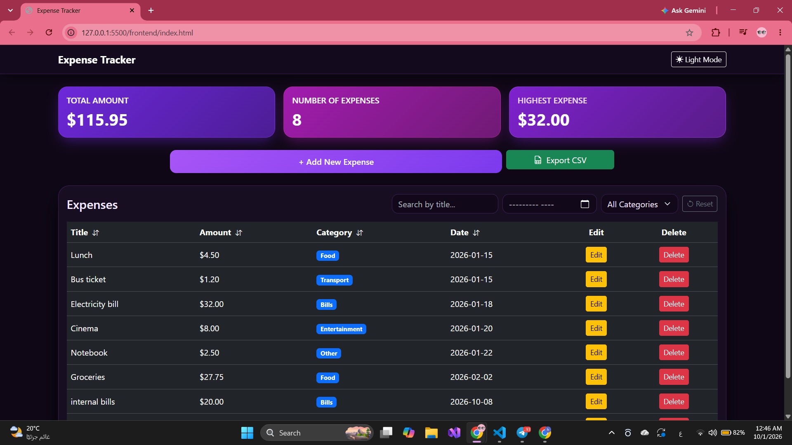
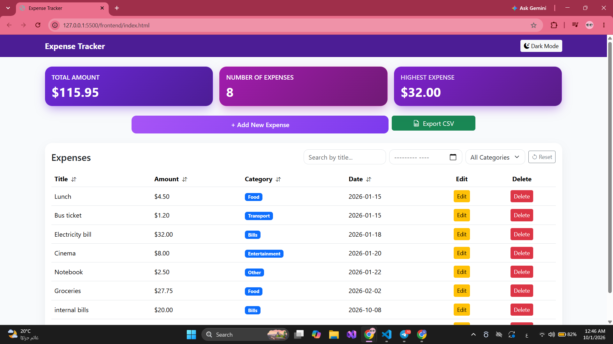
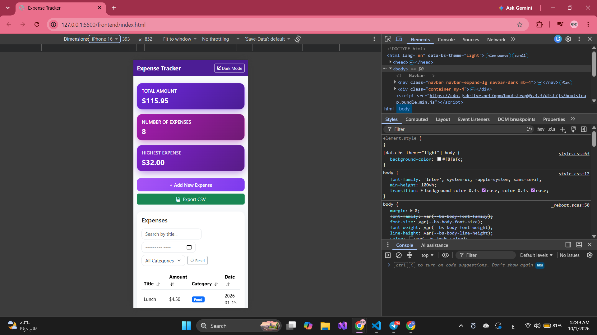

# Expense Tracker
     A responsive web-based financial dashboard built with Bootstrap 5 and Pure JavaScript to track daily expenses, income, and budgets in real time.
     Features dynamic data sorting, category filtering, theme toggling, and seamless CSV data export without external libraries.


## How to run

### Backend

1. **Install required dependencies:**
     Open your terminal in the backend directory and run:
     ```bash
     npm install express cors pg dotenv
     ```
2. Set up the PostgreSQL database:
     - Create a new database in PostgreSQL.
     - Run the SQL queries provided in the schema.sql file to create the tables and insert the required schema.

3. Configure the Environment Variables (.env):
     - Create a .env file in the backend directory.
     - Fill in your database connection credentials and configuration details.

4. Start the backend server:
     ```bash
     node server.js
     ```

### Fronend
     Open index.html using the Live Server extension in VS Code (or open it directly in your browser).


## Features

<!-- List what your app can do. Tick what you finished. -->

- [x] Add an expense (with validation)
- [x] Delete an expense
- [x] Edit an expense
- [x] Filter by category
- [x] Summary cards (total, count, highest)
- [x] Data is saved in a PostgreSQL database
- [x] Dark and Light theme toggle
- [x] Export data to CSV file
- [x] Dynamic data sorting and search filtering
- [x] Responsive Summary Cards layout built with CSS Grid


### Demo
https://drive.google.com/file/d/17e0xcYG5sJaSkHPg-g5J09IB6cJB-yYa/view?usp=sharing

## Screenshots

| Dark Mode | Light Mode |
| :---: | :---: |
|  |  |

### Mobile View


## What was the hardest part?
     The most challenging part of this project was developing `app.js`. Managing all the client-side logic in a single file—including manual DOM updates, real-time data filtering, sorting, budget calculations, and syncing state with backend API endpoints—required careful architecture. To resolve this, I structured the code into modular helper functions, applied pure JavaScript utility methods for state manipulation, and thoroughly tested API requests to maintain clean data flow without relying on external libraries.